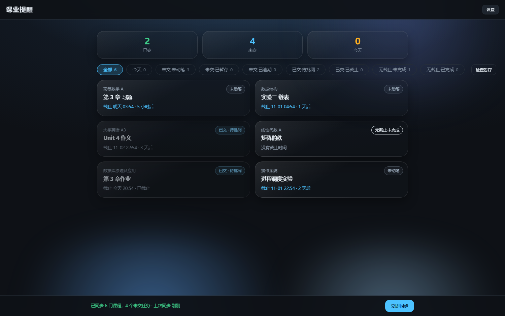

# 小肥鱼帮你做作业 · 课业提醒（桌面版）

把学习通里的**课程 / 作业 / 截止时间**集中到一个窗口里看，到点弹窗提醒；
打开某条作业可以在应用内直接浏览、读题、让 AI 或本机豆包给参考作答，并**一键填进作业页面**。
提交按钮始终由你自己点。

纯 Python 标准库 + 单文件前端，不需要安装任何第三方依赖，不编译，双击就能跑。

> 这是一个**个人学习辅助工具**：帮你少漏交作业、少在课程页之间来回点。
> 它不代替你提交，也不提供代考、替学能力，请遵守你所在学校的学术规范。



## 功能

- **作业总览**：把所有课程的未交作业按截止时间排在一起，分 9 类统计（今天 / 未交·未动笔 / 未交·已暂存 / 未交·已逾期 / 已交·待批阅 / 已交·已截止 / 无截止·未完成 / 无截止·已完成）
- **到点提醒**：24 小时 / 2 小时 / 截止那一刻，三档可选；后台每 20 秒自检，关掉窗口也会通过系统通知提醒
- **作业页内嵌浏览**：带你的登录态代理学习通页面，图片、表格都能正常显示
- **读题**：一键把这一页的题目（题型 / 题干 / 选项 / 空数）读成结构化文本
- **读图转写**：题目里是表格截图、公式图时，用视觉模型转成 markdown 表格文字
- **AI 解题**：默认“讲解”模式；也可生成可填入的答案，**由你核对后再点“填入作业页面”**
- **逐题问豆包**：对带图片的题目，自动把**整题（题干+选项）截图**发给本机豆包客户端，取回答案并汇总
- **粘贴答案**：别的软件/同学给的答案整段粘进来，自动识别题号，相同的不动、不同的覆盖
- **外观**：云母（悬浮卡片）/ 原版（平铺）两种排版 × 清透 / 标准 / 磨砂三档材质，可开关地面光斑
- **登录零门槛**：点一下打开登录窗口，在里面正常登录，回来点“我登录好了”即可（自动读取 Cookie，登录态只存本机）

## 快速开始（三步）

1. **装 Python**（只需一次）：到 <https://www.python.org/downloads/> 下载 3.9 以上版本，安装时勾选 **Add python.exe to PATH**。
2. **双击 `启动小肥鱼.bat`**。会自动打开一个无地址栏的应用窗口，先播 4 秒开机动画。
3. **登录**：点「① 打开登录窗口去登录」→ 在弹出的浏览器里登录学习通 → 回到本应用点「② 我登录好了，开始同步」。

之后每次双击 `启动小肥鱼.bat` 就行；要彻底退出后台，双击 `停止小肥鱼.bat`。

> 只支持 Windows 10/11（依赖 Edge 或 Chrome 做登录窗口与页面代理）。
> 应用的窗口、登录配置、截图缓存都放在 `%LOCALAPPDATA%` 下，不写系统目录。

## 配置（都在「设置」里）

| 项目 | 说明 |
| --- | --- |
| 后台检查 | 每 15 / 30 / 60 分钟同步一次（关掉窗口也继续） |
| 提醒 | 提前 24 小时 / 提前 2 小时 / 截止那一刻 |
| 解题助手 | **自备接口**（填接口地址、模型名、API Key，如 `https://api.deepseek.com/v1` + `deepseek-chat`）或**免费通道**（不用 Key，慢且有频率限制） |
| 豆包 | 「逐题问豆包」需要本机安装豆包客户端（默认路径 `%LOCALAPPDATA%\Doubao\Application\Doubao.exe`） |

AI Key 只保存在本机 `data.json` 里，不会上传到任何服务器（除了你自己填的那个 AI 接口）。

## 目录结构

```
xiaofeiyu-pc/
├── app.py              本地服务（HTTP API + 学习通代理 + 作业解析 + AI/豆包调用）
├── ui.html             全部界面（单文件内联 CSS/JS）
├── doubao.ps1          豆包客户端自动化（粘图、发问、截回复）
├── 启动小肥鱼.bat      双击启动（自动找 Python）
├── 停止小肥鱼.bat      停止后台服务
├── 使用说明.txt        图文版使用说明（推荐先看）
├── icon.ico            应用图标
├── img/logo.png        启动页图标
└── docs/界面预览.png   截图
```

运行时会在同目录生成：`data.json`（设置 / 登录态 / 作业缓存）、`app.log`（日志）、`imgcache/`（图片缓存）。

## 常见问题

**Q：提示「还没检测到登录状态」？**
在打开的登录窗口里把学习通登录完整（能看到「我」的页面），再回应用点「我登录好了」。

**Q：作业页一片空白 / 图片裂开？**
点工具行的「刷新页面」；图片是走本机代理抓取的，偶尔图床慢。仍不行就「在浏览器打开」用系统浏览器看（那里需要单独登录一次）。

**Q：AI 提示 401 / 403？**
自备接口的 Key 没填或不对。要么填 Key，要么点「改用免费通道再试一次」。

**Q：免费通道报限流？**
公共接口每个 IP 每 30 秒只能发 1 次，等一会儿再点，或换自备接口。

**Q：豆包没反应 / 提示窗口太小？**
程序会自动把豆包窗口还原并放大到约 1180×900。跑的时候别动鼠标键盘——它靠剪贴板粘贴和截屏工作；前台被切走会主动停止，不会误发。

**Q：会替我提交作业吗？**
不会。填写是自动的，**提交必须你自己点**，程序不碰提交按钮。

## 隐私

- 账号密码全程在学习通官方页面输入，应用不经手、不保存。
- 登录态（Cookie）保存在本机 `data.json`，不上传。
- 课程、作业、答案缓存都在本机；应用本身没有服务器。
- 唯一的外发是：你主动点 AI 解题/读图时，题目文本或题目截图会发到**你自己配置的接口**。

## 免责声明

本项目仅用于个人学习辅助，**禁止用于代考、替学、绕过考核等违规用途**。
使用本工具可能与学习通的服务条款冲突，账号风险（如被限流、封禁）由使用者自行承担。
作者不对使用本项目产生的任何后果负责。请先确认你所在学校/课程允许此类辅助工具。

## 许可证

[MIT](LICENSE)

## 贡献

欢迎提 Issue / PR：修选择器、适配学习通改版、改 UI 都可以。
提交前请确认不要包含任何真实账号信息、Cookie、课程数据或截图。
